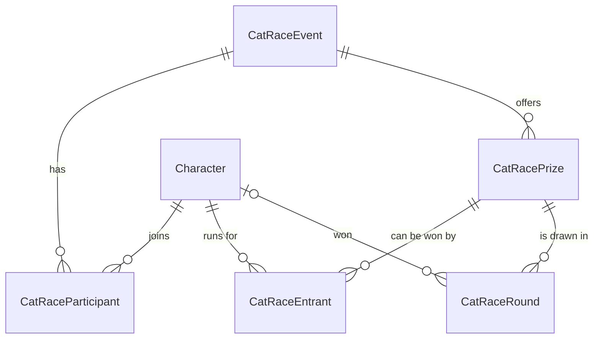

# Đua mèo - Quay thưởng trong bang

Ngày: 2026-10-12 · Trạng thái: **đã triển khai** · Nguồn: phiên phỏng vấn design tree
2026-10-11 / 2026-10-12 (Q1-Q45) · Prototype hiển thị:
[artifact riêng tư](https://claude.ai/artifact/YU5xYVfM94f1LaPrirgN6g) · Plan:
[`../custom-plan/2026-10-12-cat-race-plan.md`](../custom-plan/2026-10-12-cat-race-plan.md)

## 1. Vấn đề

Bang phát quà (Thiên thưởng, tiền mặt, thẻ tháng...) bằng cách quay ngẫu nhiên, hiện làm ngoài app
và không để lại dấu vết. Cần một màn quay thưởng vui mắt, admin chạy và share màn hình qua Discord,
kết quả do server quyết định và lưu lại để đối chứng. Bang tối đa **80 người**.

## 2. Mục tiêu

- Admin tạo một **đợt quay** gồm nhiều **hạng mục giải** tự đặt, mỗi hạng mục có số lượng.
- Hai **chế độ** chọn khi tạo đợt: **Thường** (mỗi người một cơ hội) và **Vé** (mỗi người 1-3 vé,
  mỗi vé là một con mèo trên đường đua).
- Mỗi **vòng đua** ra đúng một người thắng cho một hạng mục; các hạng mục quay xen kẽ tuỳ ý.
- Số lượng, hạng mục, người tham gia, số vé và danh sách được đua sửa được giữa chừng.
- Người thắng do server chọn và lưu **trước** khi animation chạy; client chỉ diễn lại.
- Kết thúc đợt thì bot post một bài tổng kết lên Discord.
- Giao diện đẹp, mượt tới 240 con mèo: mèo pixel-art, loại dần, nước rút, confetti.

Ngoài phạm vi (đã chốt bỏ):

- Âm thanh (Q15).
- Realtime cho nhiều người xem cùng lúc (Q5) - admin share màn hình.
- Xem lại animation một vòng cũ (Q17) - không lưu seed kịch bản.
- Khách ngoài bang (Q3).
- Sửa tay danh sách người thắng không qua đua (Q30) - gỡ người thắng bằng cách huỷ vòng.
- Mở lại đợt đã kết thúc; huỷ vòng sau khi đợt đã kết thúc (Q35).
- Chế độ khác nhau cho từng hạng mục trong cùng một đợt (Q36).

## 3. Quyết định đã chốt

| # | Câu hỏi | Quyết định |
|---|---|---|
| D1 | Ai dùng | Chỉ `ADMIN` (web lẫn API). Thành viên không thấy menu, không gọi được endpoint. (Q2) |
| D2 | Lối vào | Item "Đua mèo" (icon lucide `Cat`) trong dropdown user, trên mục chọn theme, chỉ hiện với ADMIN. Route `/dua-meo`. (Q14) |
| D3 | Đơn vị | Đợt → hạng mục → vòng. Mỗi vòng một người thắng, admin chọn hạng mục trước mỗi vòng. |
| D4 | Ai quyết định | Server chọn bằng `crypto.randomInt`, lưu vòng trong cùng transaction, trả về người thắng. Client diễn animation sao cho người đó về nhất. F5 không đổi kết quả. (Q7) |
| D5 | Chế độ | `STANDARD` hoặc `TICKET`, chọn khi tạo đợt; đổi được chỉ khi đợt chưa có vòng nào. (Q36) |
| D6 | Vé | Chỉ ở chế độ `TICKET`. Mỗi người tham gia có **một số vé cho cả đợt** (áp cho mọi hạng mục), số nguyên 1-3, mặc định 1. Không có 0 vé: muốn loại thì bỏ tick. Sửa trong dialog Người tham gia, giữa các vòng. Ở `STANDARD` mọi người coi như 1 vé và UI ẩn cột vé. (Q37, Q43) |
| D7 | Hạng mục | Tên, số lượng, bậc giá trị (`HIGH`/`MEDIUM`/`LOW`), thứ tự. Đợt mới tự điền sẵn hạng mục của đợt gần nhất. (Q22) |
| D8 | Sửa số lượng | Tăng tuỳ ý; giảm không thấp hơn số vòng thắng còn hiệu lực. Thêm hạng mục bất kỳ lúc nào; xoá chỉ khi hạng mục chưa có vòng nào (kể cả vòng đã huỷ). (Q23) |
| D9 | Danh sách đua theo hạng mục | Mỗi hạng mục có danh sách riêng, mặc định = người tham gia đợt. Người thắng tự bị gỡ khỏi danh sách của hạng mục đó (mất mọi vé ở hạng mục đó). Admin tick / bỏ tick tự do, kể cả tick lại người đã thắng. (Q24, Q30, Q44) |
| D10 | Người tham gia đợt | Mặc định toàn bộ `Character`, tick / bỏ tick lúc tạo, gỡ và thêm lại tự do giữa các vòng. (Q25, Q34) |
| D11 | Điều kiện quay | Đợt đang mở, hạng mục chưa đủ số lượng, danh sách đua có **ít nhất 2 người**. Không đủ thì khoá nút Đua, hiện lý do. |
| D12 | Huỷ vòng | Chỉ khi đợt đang mở. Bắt buộc nhập lý do. Suất trả về hạng mục; người thắng được thêm lại vào danh sách đua của hạng mục nếu còn là người tham gia đợt. Vòng huỷ vẫn hiện, gạch ngang kèm lý do. (Q28, Q35) |
| D13 | Kết thúc đợt | Admin bấm. Không tự đóng khi đủ giải. Đợt đã kết thúc chỉ xem, không mở lại. (Q26, Q35) |
| D14 | Xoá đợt | Chỉ khi đợt chưa có vòng nào. (Q31) |
| D15 | Tên đợt | Không bắt buộc; trống thì server đặt "Đợt quay dd/MM/yyyy" theo giờ VN. Đổi tên được. (Q32) |
| D16 | Discord | Một bài tổng kết, gom theo hạng mục, tag `<@discordId>` người thắng (người chưa liên kết Discord hiện tên), không ghi số vé. Admin bấm nút trên đợt đã kết thúc; post một lần, đánh dấu `discordPostedAt` chỉ sau khi Discord nhận. (Q10, Q19, Q27, Q39) |
| D17 | Kênh Discord | Purpose mới **`GENERAL_NOTI`** trong bảng `BotChannel`, cấu hình bằng `/cau-hinh-kenh muc-dich:Thông báo chung`. Không dùng env. Kênh dùng chung cho các thông báo sau này. (Q11 → Q33) |
| D18 | Tốc độ | Nhanh / Vừa / Chậm = 6 / 12 / 20 giây. Chọn ở client, nhớ bằng `localStorage`, không lưu DB. (Q21) |
| D19 | Hiển thị đường đua | Cách **C - loại dần trong một cuộc đua** (mục 8.4): cả đàn → mốc 40% loại nửa sau → mốc 70% còn 8 → nước rút theo làn. Đã thử trên prototype với 14-240 mèo. (Q40, Q45) |
| D20 | Hình mèo | Sprite pixel-art CC0, tô màu theo `GuildClass`, avatar Discord trong bong bóng (chữ cái đầu trên nền màu phái nếu không có). Không tìm được sprite CC0 thì vẽ pixel bằng code như prototype. Các mèo của cùng một người mang nhãn `Tên #2`. (Q8, Q38) |
| D21 | Công nghệ vẽ | Đường đua vẽ bằng **canvas** (`konva` có sẵn hoặc canvas 2D thuần + `requestAnimationFrame`; plan chọn sau khi đo). Nghiệm thu: 240 mèo khoảng 60fps trên laptop phổ thông. UI xung quanh là DOM, chuyển cảnh bằng CSS với token `--duration-*` và chỉ `transform`/`opacity` (`.claude/rules/web/interaction.md`) - **không thêm `motion`**; confetti bằng `canvas-confetti`. (Q18, Q41) |
| D22 | Lối tắt | Nút "Bỏ qua" khi đang đua; `prefers-reduced-motion` thì hiện kết quả ngay, không chạy đua. (Q20) |

## 4. Mô hình dữ liệu

Tên bảng và cột là đề xuất; plan được đổi nếu có lý do, nhưng phải giữ đủ các ràng buộc dưới đây.



| Model | Cột | Ghi chú |
|---|---|---|
| `CatRaceEvent` | `id`, `name`, `mode`, `createdById`, `createdAt`, `endedAt?`, `discordPostedAt?` | `mode` là enum `CatRaceMode` (`STANDARD`/`TICKET`). `endedAt` null = đang mở. `createdById` là id thường, không relation (cùng lý do `markedByCharacterId`). |
| `CatRaceParticipant` | `eventId`, `characterId`, `tickets` | Khoá chính ghép. `tickets` 1-3, mặc định 1; ở `STANDARD` luôn 1. Cascade theo event **và** theo character. |
| `CatRacePrize` | `id`, `eventId`, `name`, `quantity`, `tier`, `sortOrder` | `tier` là enum `PrizeTier` (`HIGH`/`MEDIUM`/`LOW`). `quantity ≥ 1`. |
| `CatRaceEntrant` | `prizeId`, `characterId` | Danh sách đua hiện tại của hạng mục. Khoá chính ghép. Cascade theo prize và character. Số vé đọc từ `CatRaceParticipant`, không lưu lặp ở đây. |
| `CatRaceRound` | `id`, `prizeId`, `winnerCharacterId?`, `winnerName`, `winnerGuildClass`, `winnerTickets`, `entrantCount`, `totalTickets`, `drawnById`, `drawnAt`, `voidedAt?`, `voidReason?` | Người thắng chụp tên và phái lúc quay; FK `SetNull` vì `Character` bị hard delete. `entrantCount` (số người) và `totalTickets` (số vé, = `entrantCount` ở `STANDARD`) để lịch sử ghi "thắng giữa N người" / "thắng với 3/25 vé". `drawnById` id thường. |

`CatRaceMode` và `PrizeTier` là enum Prisma, đồng bộ với `packages/shared/enums` (`prisma.md`).

Bất biến:

- Một vòng **còn hiệu lực** = `voidedAt IS NULL`. Số vòng còn hiệu lực của một hạng mục ≤ `quantity`.
- `CatRaceEntrant` của một hạng mục ⊆ `CatRaceParticipant` của đợt. Gỡ người khỏi đợt thì gỡ khỏi
  mọi hạng mục của đợt.
- Thêm người vào đợt (kể cả thêm lại người vừa gỡ) thì thêm vào danh sách đua của **mọi hạng mục chưa
  đủ số lượng**, trừ hạng mục người đó đang có vòng thắng còn hiệu lực.
- Hạng mục mới: danh sách đua = toàn bộ người tham gia đợt.
- Ở `STANDARD`, mọi `tickets` = 1; API từ chối giá trị khác (400).
- Thành viên bị xoá khỏi bang: cascade gỡ khỏi đợt và danh sách đua; vòng đã thắng giữ tên chụp lại.
  Tạo lại thành viên đó là một `Character` mới, admin thêm vào đợt như người mới.
- Mọi thời điểm (`createdAt`, `drawnAt`, `endedAt`...) lấy từ `Clock`, không `new Date()`
  (`architecture.md` §7).

Migration bật RLS trên các bảng mới, cùng mẫu các bảng hiện có; kiểm tra Data API grants
(`production.md` §5).

## 5. Quy tắc quay

`POST` tạo vòng, trong **một transaction**:

1. Đợt tồn tại và đang mở; không thì 409.
2. Hạng mục thuộc đợt; số vòng còn hiệu lực < `quantity`; không thì 409 "Hạng mục đã đủ giải".
3. Danh sách đua ≥ 2 người; không thì 409 "Cần ít nhất 2 người để đua".
4. Trải danh sách đua thành danh sách vé (người có `tickets = k` chiếm k vé), chọn
   `ticket = tickets[crypto.randomInt(tickets.length)]`. Người thắng là chủ vé đó; xác suất tỉ lệ
   với số vé. Ở `STANDARD` mỗi người một vé.
5. Ghi `CatRaceRound` (kèm `winnerTickets`, `entrantCount`, `totalTickets`), xoá `CatRaceEntrant`
   của người thắng ở hạng mục này.
6. Trả về vòng vừa tạo **kèm danh sách người đã đua và số vé của từng người** (trạng thái lúc rút,
   trước bước 5) và **số thứ tự vé thắng** của người thắng, để client dựng đúng đàn mèo và cho đúng
   con mèo về nhất.

Hai yêu cầu quay đồng thời cho một hạng mục (hai admin, hoặc bấm đúp) **không được** vượt số lượng
hay chọn từ danh sách đã đổi. Cơ chế khoá (khoá dòng hạng mục, cột version, hay isolation level) do
plan chọn; spec chỉ đòi bất biến ở mục 4 luôn đúng. Web còn khoá nút Đua trong lúc chờ phản hồi.

Huỷ vòng (D12): đợt đang mở, vòng chưa huỷ, lý do 1-255 ký tự. Ghi `voidedAt`, `voidReason`; nếu
người thắng còn tồn tại và còn tham gia đợt thì thêm lại vào `CatRaceEntrant` của hạng mục.

Không có cờ "đang đua" ở server: animation chỉ là trình diễn của một kết quả đã lưu.

## 6. API

Module mới `src/modules/cat-race/`, mọi endpoint `@UseGuards(JwtAuthGuard, AdminGuard)`. Shape
request / response là Zod schema trong `packages/shared/schemas/cat-race.schema.ts`. Đường dẫn dưới
đây là đề xuất.

| Method | Path | Việc |
|---|---|---|
| `GET` | `/cat-races` | Danh sách đợt, mới nhất trước: tên, chế độ, trạng thái, số vòng, thời gian. |
| `GET` | `/cat-races/prefill` | Hạng mục của đợt gần nhất (tên, số lượng, bậc, thứ tự) để điền form tạo đợt. Rỗng nếu chưa có đợt nào. |
| `POST` | `/cat-races` | Tạo đợt: `name?`, `mode`, `participants[] { characterId, tickets }`, `prizes[]`. |
| `GET` | `/cat-races/:id` | Chi tiết: đợt, người tham gia (kèm `tickets`, `discordId`, `discordAvatar`, `guildClass`), hạng mục kèm danh sách đua, mọi vòng. |
| `PATCH` | `/cat-races/:id` | Đổi tên; đổi `mode` khi chưa có vòng nào (đổi sang `STANDARD` đặt mọi `tickets` về 1). |
| `DELETE` | `/cat-races/:id` | Xoá đợt chưa có vòng nào; có vòng thì 409. |
| `PUT` | `/cat-races/:id/participants` | Đặt lại người tham gia và số vé (áp quy tắc thêm / gỡ ở mục 4). |
| `POST` | `/cat-races/:id/prizes` | Thêm hạng mục. |
| `PATCH` | `/cat-races/:id/prizes/:prizeId` | Sửa tên, số lượng (D8), bậc, thứ tự. |
| `DELETE` | `/cat-races/:id/prizes/:prizeId` | Xoá hạng mục chưa có vòng nào. |
| `PUT` | `/cat-races/:id/prizes/:prizeId/entrants` | Đặt lại danh sách đua; mọi id phải là người tham gia đợt, không thì 400. |
| `POST` | `/cat-races/:id/rounds` | Quay một vòng: `{ prizeId }` (mục 5). |
| `POST` | `/cat-races/:id/rounds/:roundId/void` | Huỷ vòng: `{ reason }`. |
| `POST` | `/cat-races/:id/end` | Kết thúc đợt. Gọi lại trên đợt đã kết thúc trả nguyên trạng. |
| `POST` | `/cat-races/:id/announce` | Post tổng kết lên Discord (mục 7). |

Mọi thao tác ghi trên đợt đã kết thúc (trừ `announce`) trả 409. Thông báo lỗi bằng tiếng Việt,
theo cách các module hiện có trả lỗi.

`discordAvatar` hiện chỉ đi ra browser qua `/auth/me` (`architecture.md` §5). Endpoint chi tiết đợt
mở thêm `discordId` + `discordAvatar` của người tham gia; chấp nhận được vì chỉ ADMIN gọi được.
`architecture.md` §5 phải ghi thêm ngoại lệ này.

## 7. Discord

- **Kênh**: thêm `'GENERAL_NOTI'` vào union `BotChannelPurpose` (`bot-channel.service.ts:9`), thêm
  choice `{ name: 'Thông báo chung', value: 'GENERAL_NOTI' }` và câu xác nhận vào `PURPOSE_CHOICES` /
  `PURPOSE_COPY` của `/cau-hinh-kenh` (`commands/cau-hinh-kenh.command.ts:22-46`). `purpose` là
  `String` nên **không cần migration**. Sau khi deploy chạy `pnpm --filter api discord:register` một
  lần để Discord thấy choice mới.
- **Chưa cấu hình kênh**: `BotChannelService.get('GENERAL_NOTI')` trả `null` (trạng thái bình thường,
  không kiểm tra được lúc khởi động - `bot-channel.service.ts:24-27`). `announce` khi đó trả 409
  "Chưa đặt kênh thông báo chung. Chạy `/cau-hinh-kenh muc-dich:Thông báo chung` trong kênh muốn
  nhận rồi thử lại." Không post, không ghi `discordPostedAt`.
- Gửi qua `DiscordRest.postMessage` có sẵn (`discord-rest.ts:125`), theo mẫu
  `formation-announcer.service.ts`: bot thiếu quyền thì trả lỗi tiếng Việt chỉ cách cấp quyền.
- Chỉ đợt đã kết thúc và `discordPostedAt` null mới post được; đã post thì 409. Discord từ chối thì
  không ghi `discordPostedAt`, admin bấm lại được.
- Nội dung: một embed, tiêu đề là tên đợt; mỗi hạng mục (theo `sortOrder`) một field liệt kê người
  thắng còn hiệu lực. Người có `discordId` được tag `<@id>` (có ping); người đã bị xoá hoặc chưa liên
  kết thì hiện `winnerName`. Hạng mục không ai thắng thì bỏ qua. Không ghi số vé.

## 8. Giao diện

### 8.1 Lối vào và route

- `ROUTES` thêm `/dua-meo` và `/dua-meo/[id]`; `/dua-meo` vào `ADMIN_PATH_PREFIXES`; page re-check
  `getSession()` + `canManageGuild`.
- `user-menu.tsx`: thêm item "Đua mèo" (link) trên `ThemeRadioItems`, chỉ khi `canManageGuild(role)`.
- Logic nằm trong `features/cat-race/` (`api/`, `hooks/`, `store/`, `lib/`, `components/`).

### 8.2 `/dua-meo` - danh sách đợt

- Nút "Tạo đợt quay" mở form: tên (không bắt buộc), **chế độ** (Thường / Vé), danh sách hạng mục
  (điền sẵn từ `prefill`, sửa / thêm / xoá dòng), danh sách người tham gia (tick tất cả mặc định, có ô
  tìm; ở chế độ Vé mỗi dòng có ô số vé 1-3).
- Danh sách đợt: tên, chế độ, trạng thái (Đang mở / Đã kết thúc / Đã post), số giải đã trao, ngày.
  Bấm vào mở `/dua-meo/[id]`.

### 8.3 `/dua-meo/[id]` - màn quay

```
┌─ Đợt: Quà Trung Thu · Chế độ Vé ────────────── [Kết thúc đợt] ┐
│ Hạng mục:  [Thiên thưởng 1/2] [Tiền mặt 3/5]                  │
│            [Thẻ tháng 8/15 ✎]  [+ Hạng mục]                    │
├─────────────────────────────────┬─────────────────────────────┤
│ ĐƯỜNG ĐUA (canvas)              │ Đang dẫn (top 5, khi đua)   │
│ 78 người · 160 vé               │ Người thắng đợt này         │
│                                 │ ★ Thiên thưởng: An          │
│                                 │ $ Tiền mặt: Bình, …         │
│ Tốc độ: (Nhanh)(Vừa)(Chậm)      │ ▢ Thẻ tháng: …              │
│ [Danh sách đua 78 ✎]            │ [Người tham gia 80 ✎]       │
│          [ ĐUA: Thẻ tháng #9 ]  │                             │
└─────────────────────────────────┴─────────────────────────────┘
```

- **Chip hạng mục** là bộ chọn: bấm chọn hạng mục cho vòng tới; hiện `đã trao/số lượng`, màu theo
  bậc; ✎ mở popover sửa tên / số lượng / bậc. Hạng mục đã đủ hoặc thiếu người hiện trạng thái khoá.
- **Danh sách đua ✎**: dialog tick / bỏ tick cho hạng mục đang chọn; người đã thắng hạng mục này có
  nhãn "đã trúng".
- **Người tham gia ✎**: dialog tick / bỏ tick người tham gia đợt; ở chế độ Vé kèm ô số vé 1-3.
- **Người thắng**: gom theo hạng mục; mỗi dòng có menu "Huỷ vòng" (dialog nhập lý do). Vòng huỷ gạch
  ngang, hover / bấm xem lý do. Ở chế độ Vé hiện "3/160 vé".
- **Đợt đã kết thúc**: ẩn mọi nút sửa, nút Đua và Huỷ vòng; hiện nút "Đăng tổng kết lên Discord" (ẩn
  sau khi post).

### 8.4 Một vòng đua (cách C - loại dần)

Đàn mèo = một con mèo cho mỗi vé của mỗi người trong danh sách đua (ở `STANDARD` mỗi người một con).
Con mèo về nhất là con mang **đúng số thứ tự vé thắng** server trả về.

1. Bấm Đua: gọi API, nút khoá. Lỗi thì toast, không chạy animation.
2. Đếm ngược 3-2-1; panel phải mờ đi và trượt ra (CSS `transform`/`opacity`, không đổi kích thước
   layout).
3. **Cả đàn**: mèo xếp lưới dày sau vạch xuất phát, sprite nhỏ; khi ≤ 20 mèo thì mỗi con một làn và
   có tên. Chỉ top 3 có bong bóng avatar và tên.
4. **Mốc 1 (40% thời lượng)**: nửa đàn phía sau mờ dần rồi biến mất.
5. **Mốc 2 (70%)**: còn 8 con. Đường đua giãn thành 8 làn (xếp theo thứ hạng lúc đó), sprite to,
   mọi con có avatar và tên; camera zoom vào đoạn cuối đường.
6. **Nước rút**: tốc độ dao động, có vượt mặt, sát nút; con mang vé thắng về nhất. Bảng top 5 live.
7. Về đích: overlay người thắng (avatar, tên, phái, hạng mục, màu theo bậc; chế độ Vé thêm "thắng với
   3/160 vé") + `canvas-confetti`. Bấm "Đua tiếp" về màn quay với dữ liệu mới.

Quy tắc kịch bản (thuần hàm trong `lib/`, test được):

- 8 con vào nước rút = con thắng + 7 con chọn ngẫu nhiên; các con còn lại về chậm hơn hẳn nên luôn
  nằm nửa sau ở mốc loại. Đàn ≤ 8 con thì bỏ bước 3-5, chạy thẳng nước rút theo làn.
- Không con nào chạy lùi; về đích đúng thời lượng đã chọn (D18).
- "Bỏ qua" nhảy thẳng tới bước 7. `prefers-reduced-motion`: bỏ bước 2-6.

Tham chiếu: prototype `C · Loại dần` (link ở đầu file) - code giả, không dùng lại nguyên văn.

### 8.5 Điện thoại

Panel xếp chồng dưới đường đua; đường đua chạy **dọc** (xuất phát ở trên, đích ở dưới). Không cuộn
ngang trang.

## 9. Kiểm thử

- API (Jest), `cat-race` service: chọn người thắng trong danh sách đua; xác suất theo vé (rút với
  `randomInt` giả lập, kiểm tra ánh xạ vé → người); gỡ người thắng khỏi danh sách; từ chối khi đủ số
  lượng, dưới 2 người, đợt đã kết thúc; `tickets ≠ 1` ở `STANDARD`; đổi `mode` khi đã có vòng; giảm
  số lượng dưới số đã trao; xoá hạng mục / đợt đã có vòng; huỷ vòng trả suất và thêm lại người thắng;
  quy tắc thêm / gỡ / thêm lại người tham gia; tên mặc định theo giờ VN qua `Clock`.
- API, Discord: nội dung embed (tag vs tên, bỏ hạng mục trống, không có số vé); 409 khi chưa cấu hình
  `GENERAL_NOTI`; chỉ ghi `discordPostedAt` khi Discord nhận; 409 khi đã post. `/cau-hinh-kenh` nhận
  choice mới.
- Web (Vitest): kịch bản đua (con mang vé thắng về nhất; 8 con nước rút chứa con thắng; con bị loại
  luôn nằm nửa sau ở mốc; không chạy lùi; tổng thời lượng đúng tốc độ; đàn ≤ 8 bỏ pha loại);
  `user-menu` hiện item cho ADMIN, ẩn với MEMBER; trạng thái khoá của chip hạng mục.
- Hiệu năng: đo 240 mèo trên trình duyệt thật trước khi chốt công nghệ vẽ (D21).

## 10. Tài liệu cần cập nhật

- `architecture.md` §5: thêm các model mới vào sơ đồ và bảng; ghi ngoại lệ `discordAvatar` (mục 6);
  dòng `BotChannel` đổi "Two rows at most" thành ba purpose, thêm `GENERAL_NOTI`.
- `architecture.md` §3.3: module `cat-race`.
- `docs/production.md` và `README.md` (đang mô tả `/cau-hinh-kenh`): thêm mục đích "Thông báo chung"
  và bước `discord:register` sau deploy.

## Nguồn

- Quyết định Q1-Q45: phiên phỏng vấn 2026-10-11 / 2026-10-12.
- Prototype hiển thị: https://claude.ai/artifact/YU5xYVfM94f1LaPrirgN6g (riêng tư).
- `apps/api/prisma/schema.prisma:38-64` (`Character`), `:209-214` (`BotChannel`).
- `apps/api/src/modules/characters/characters.service.ts:220-240` (hard delete thành viên).
- `apps/api/src/modules/discord-bot/bot-channel.service.ts:9,24-27` (`BotChannelPurpose`, `null` khi
  chưa cấu hình).
- `apps/api/src/modules/discord-bot/commands/cau-hinh-kenh.command.ts:22-46` (choice và câu xác nhận).
- `apps/api/src/modules/discord-bot/discord-rest.ts:125` (`postMessage`).
- `apps/api/src/modules/discord-bot/formation-announcer.service.ts` (mẫu post và lỗi quyền).
- `apps/web/features/auth/components/user-menu.tsx:48-113` (dropdown user).
- `apps/web/features/auth/core/access.ts:10,13` (`PUBLIC_PATH_PREFIXES`, `ADMIN_PATH_PREFIXES`).
- `packages/shared/lib/permissions.ts:10` (`canManageGuild`).
- `docs/architecture.md` §5, §7.
