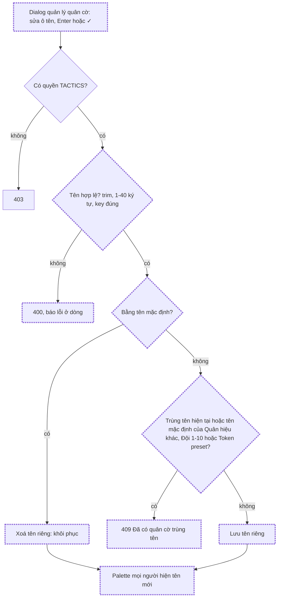
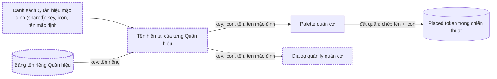

# Đổi tên Quân hiệu

Status: approved

## Problem Statement

Bảng quân cờ của chiến thuật luôn có 7 **Quân hiệu** (Đội công, Đội thủ, Cơ động, Trinh sát, Tập
kết, Đội trụ, Bảo tiêu). Tên của chúng được viết cứng trong code. Guild lại có cách gọi riêng, nên
admin phải đổi tên từng quân sau khi đặt lên map, hoặc phải tạo thêm Token preset trùng icon. Không có
cách nào đặt tên một lần cho cả guild.

## Solution

Người có Capability `TACTICS` đổi được tên của từng Quân hiệu cho cả guild, ngay trong dialog quản lý
quân cờ. Icon không đổi. Palette của mọi người hiện tên mới. Khôi phục một quân là đưa nó về tên mặc
định. Các Placed token đã có trên map giữ tên lúc được đặt, nên chiến thuật cũ không thay đổi.

## Flows

### Khi admin lưu tên một Quân hiệu, chuyện gì xảy ra?

Thêm Token preset cũng đi qua bước kiểm tra trùng tên, và so cả với tên hiện tại lẫn tên mặc định của
mọi Quân hiệu. Tên mặc định luôn được giữ chỗ, nên khôi phục không bao giờ tạo ra hai quân cùng tên.

### Tên của Quân hiệu đi từ đâu tới đâu?

Placed token chỉ chép tên lúc được đặt và không có đường nối ngược về bảng tên riêng. Vì vậy đổi tên
không chạm tới chiến thuật đã vẽ.

## User Stories

1. As an admin có quyền `TACTICS`, I want đổi tên một Quân hiệu, so that palette dùng đúng cách gọi của guild.
2. As an admin, I want tên mới hiện cho mọi thành viên, so that cả guild nói cùng một ngôn ngữ trên map.
3. As an admin, I want lưu tên của một dòng bằng Enter hoặc nút ✓ của dòng đó, so that mỗi lần đổi tên là một thao tác độc lập.
4. As an admin, I want thấy toast "Đã đổi tên …" sau khi lưu, so that tôi biết thay đổi đã được ghi.
5. As an admin, I want rời ô tên mà chưa lưu thì thay đổi bị bỏ, so that không có lần lưu ngoài ý muốn.
6. As an admin, I want ô tên dùng tên mặc định làm placeholder, so that tôi luôn biết quân hiệu gốc là gì.
7. As an admin, I want nút "Khôi phục" trên quân hiệu đã đổi tên, so that tôi đưa nó về tên mặc định chỉ với một lần bấm.
8. As an admin, I want nút "Khôi phục" ẩn với quân hiệu đang dùng tên mặc định, so that dialog không có nút thừa.
9. As an admin, I want lưu tên trống (sau khi trim) bị chặn, so that không có quân hiệu nào mất tên.
10. As an admin, I want tên dài hơn 40 ký tự bị chặn, so that tên vừa với palette và giống giới hạn của Token preset.
11. As an admin, I want tên trùng tên hiện tại hoặc tên mặc định của Quân hiệu khác, trùng "Đội 1"-"Đội 10" hoặc trùng một Token preset bị chặn (trim, không phân biệt hoa thường), so that palette không có hai quân cùng tên.
12. As an admin, I want thêm Token preset có tên trùng tên hiện tại hoặc tên mặc định của một Quân hiệu cũng bị chặn, so that ràng buộc trùng tên đúng ở cả hai chiều.
13. As an admin, I want lưu tên giống hệt tên mặc định thì được coi là khôi phục, so that không có tên riêng nào trùng tên gốc.
14. As an admin, I want icon của Quân hiệu không đổi, so that quân vẫn nhận ra được ngay trên map.
15. As an admin, I want chiến thuật đã vẽ giữ tên cũ trên các Placed token, so that bản ghi của một quyết định cũ không bị viết lại.
16. As an admin, I want quân hiệu đặt lên map sau khi đổi tên mang tên mới, so that chiến thuật mới dùng cách gọi mới.
17. As a member không có quyền `TACTICS`, I want thấy tên mới trên palette và trong viewer, so that tôi đọc chiến thuật theo cùng cách gọi.
18. As a member không có quyền `TACTICS`, I want không thấy phần sửa tên, so that tôi không thử một thao tác bị từ chối.
19. As an admin, I want nhóm "Đội 1"-"Đội 10" giữ nguyên tên, so that số đội luôn khớp với các cột của team builder.
20. As an admin, I want tooltip và nhãn `sr-only` trên palette hiện tên hiện tại, so that palette nhất quán với dialog.

## Implementation Decisions

- **Key cố định cho mỗi Quân hiệu.** Danh sách Quân hiệu (key, icon, tên mặc định, thứ tự) chuyển từ web sang `packages/shared`, vì API cần biết tên mặc định và các nhãn "Đội N" để kiểm tra trùng. Key là enum trong shared, ví dụ `attack`, `defense`, `mobile`, `scout`, `rally`, `tower`, `escort`. Cách đặt nhãn "Đội N" cũng chuyển sang shared để hai phía dùng chung.
- **Bảng mới `TacticInsigniaName`.** Mỗi hàng là tên riêng của một Quân hiệu: `key` (khoá chính), `label` (`VarChar(40)`), `updatedAt`. Không có hàng nghĩa là quân dùng tên mặc định. Đây là cấu hình chung của guild, giống `TacticTokenPreset`, và không có quan hệ tới bảng nào. Migration bật RLS cho bảng mới (test `migration-rls` bắt buộc điều này). Kiểm tra Data API grants theo production.md §5.
- **Kiểu `key` trong DB.** Cột `key` là `String`, không phải Prisma enum, giống cột `icon` của `TacticTokenPreset`. Giá trị được kiểm tra bằng Zod ở biên HTTP. Khi đọc ra, service bỏ qua và ghi log hàng có key không còn trong danh sách shared.
- **API**, trong module `tactics`:
  - `GET /tactics/insignia`: mọi người dùng đã đăng nhập. Trả về đủ 7 Quân hiệu theo thứ tự hiển thị, mỗi phần tử có `{ key, icon, label, defaultLabel }`, trong đó `label` là tên đang dùng.
  - `PUT /tactics/insignia/:key` với body `{ label }`: cần `TACTICS`. Ghi tên riêng (upsert) và trả về phần tử đã cập nhật. Nếu `label` sau khi chuẩn hoá bằng `defaultLabel` thì xoá hàng, tức là khôi phục.
  - `DELETE /tactics/insignia/:key`: cần `TACTICS`. Khôi phục tên mặc định. Gọi khi quân đã ở tên mặc định thì vẫn thành công (idempotent).
  - `:key` không hợp lệ trả về 400. Tên trùng trả về 409 với thông báo tiếng Việt, giống lỗi trùng của Token preset.
- **Schema shared.** `renameInsigniaSchema` (label: trim, 1-40 ký tự) và `tacticInsigniaSchema` (shape của response) nằm trong tactic schema của shared. API bọc chúng thành DTO, web dùng chúng để type các hàm fetch.
- **Kiểm tra trùng tên** được làm ở service, trên cả hai luồng: đổi tên Quân hiệu và tạo Token preset. Tên cần lưu được so với tên hiện tại và tên mặc định của mọi Quân hiệu khác, các nhãn "Đội 1"-"Đội 10" và mọi Token preset, sau khi trim, chuẩn hoá Unicode NFC và đưa về chữ thường. Ràng buộc `@@unique([label])` của preset vẫn giữ làm lưới an toàn.
  - **Tên mặc định luôn được giữ chỗ.** Không Quân hiệu nào khác và không Token preset nào được lấy tên mặc định của một Quân hiệu, kể cả khi Quân hiệu đó đang dùng tên riêng. Nhờ vậy khôi phục (bằng `DELETE` hoặc lưu đúng tên mặc định) không cần kiểm tra trùng và luôn thành công. Đổi lại, không hoán đổi tên giữa hai Quân hiệu được.
- **Web.**
  - Hook mới đọc danh sách Quân hiệu, cạnh `useTokenPresets`. Một mutation đổi tên và một mutation khôi phục, cả hai invalidate query key của danh sách Quân hiệu.
  - Palette lấy tên từ hook. Trong lúc đang tải, palette hiện tên mặc định từ shared, để khu vực quân cờ không bị trống hay nhảy layout.
  - Dialog quản lý quân cờ có thêm phần "Quân hiệu" ở trên phần Custom. Mỗi dòng gồm icon, ô tên (placeholder là tên mặc định), nút ✓ và nút "Khôi phục" (chỉ hiện khi đã đổi tên). Dòng lưu bằng Enter hoặc nút ✓. Rời ô mà chưa lưu thì ô trở lại tên đang dùng.
  - Dialog chỉ mở được khi người dùng có `TACTICS`, giống hiện nay.
- **Placed token không đổi.** Placed token vẫn lưu `label` và `icon` lúc được đặt (decision 3). Không có migration dữ liệu nào cho các chiến thuật hiện có.

## Testing Decisions

- Test chỉ kiểm hành vi nhìn thấy được từ bên ngoài: response HTTP, quyền truy cập, nội dung UI. Không test chi tiết cài đặt.
- Các seam (đề xuất, cần user xác nhận):
  1. **Service API** (`tactics.service.spec`, Prisma mock): tên hiện tại khi có và không có tên riêng; lưu tên bằng tên mặc định thì xoá hàng; trùng tên trả về 409 trong cả 3 trường hợp (Quân hiệu khác, "Đội N", preset), kể cả khác hoa thường và có khoảng trắng; tạo preset trùng tên một Quân hiệu đã đổi tên trả về 409; hàng có key lạ bị bỏ qua.
  2. **HTTP/quyền** (`tactics.http.spec`, `tactics-manager.http.spec`): `GET` mở cho member; `PUT` và `DELETE` cần `TACTICS`; key không hợp lệ và label quá 40 ký tự trả về 400.
  3. **UI web** (Vitest + Testing Library): `token-preset-dialog.test` cho đổi tên bằng Enter và nút ✓, rời ô thì bỏ thay đổi, nút "Khôi phục" chỉ hiện khi đã đổi tên, hiển thị lỗi 409; `token-palette.test` cho palette hiện tên đã đổi và tên mặc định khi đang tải.
  4. **Schema shared** (`tactic.schema.spec`): trim, giới hạn độ dài và key hợp lệ.
- Tham khảo cách test có sẵn của Token preset ở cả 4 seam.

## Out of Scope

- Đổi icon của Quân hiệu.
- Đổi tên nhóm "Đội 1"-"Đội 10".
- Thêm, xoá hoặc sắp xếp lại Quân hiệu.
- Đổi tên Token preset đã có (hiện chỉ thêm hoặc xoá).
- Cập nhật tên của Placed token trong các chiến thuật đã vẽ.
- Tên riêng cho từng người dùng.
- Lịch sử hay log ai đã đổi tên.

## Further Notes

- Palette đang nhận biết quân được chọn theo `label`. Ràng buộc không trùng tên giữ cho cách này đúng. Nếu đổi tên đúng lúc một người đang chọn quân hiệu đó, lựa chọn của họ có thể mất sau lần refetch tiếp theo. Chấp nhận được, vì chỉ cần bấm chọn lại.
- Thuật ngữ trong `GLOSSARY.md`: Insignia, Token preset, Placed token.
