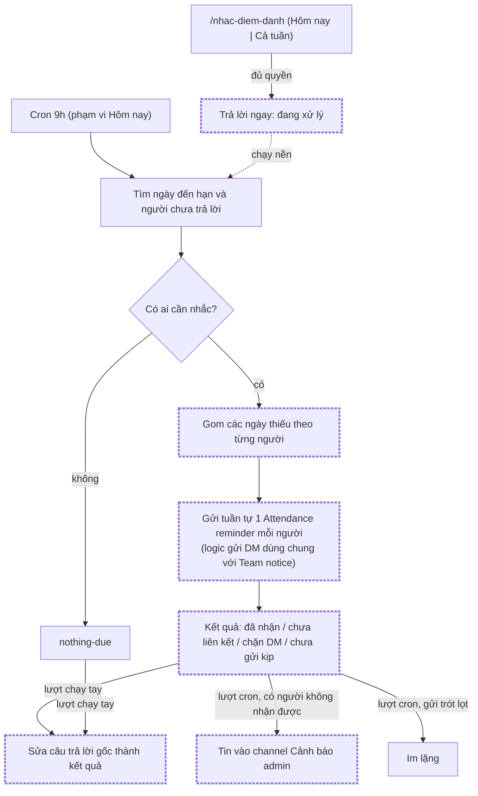
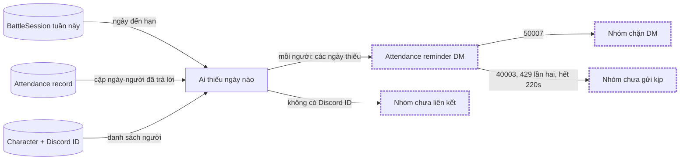

# Nhắc điểm danh qua tin nhắn riêng (Attendance reminder DM)

Status: approved

Thuật ngữ theo [`GLOSSARY.md`](../../GLOSSARY.md): **Attendance reminder** là tin nhắn riêng gửi một
nhân vật trong bang (vai trò nào cũng vậy), liệt kê các ngày đánh sắp hết hạn điểm danh mà người đó
chưa trả lời. **Team notice** là DM đội hình đã có, spec [`2026-10-19-team-notice-dm.md`](2026-10-19-team-notice-dm.md).

## Problem Statement

Mỗi sáng 9h (VN), cron nhắc điểm danh đăng một tin vào channel nhắc chung và ping mọi người chưa
trả lời cho các ngày đánh sắp hết hạn. Lệnh `/nhac-diem-danh` làm y hệt khi admin chạy tay. Một tin
ping hàng chục người trong channel chung gây ồn cho người đã điểm danh, dễ khiến cả channel bị mute,
và người cần nhắc thì lướt qua vì tin không nói riêng với họ. Admin muốn nhắc giống cách Team notice
đang làm: mỗi người nhận một tin riêng.

## Solution

Cron 9h và `/nhac-diem-danh` gửi cho mỗi người còn thiếu **một** Attendance reminder qua DM, gộp mọi
ngày đánh người đó chưa trả lời trong lượt nhắc. Tin không ping ai, không có tên người khác, và giữ
hàng nút quen thuộc (Điểm danh ngay, Xin nghỉ, Tự động điểm danh, Mở website), bấm được ngay trong DM.
Không còn tin nào trong channel chung; mục đích channel "Nhắc điểm danh" bị bỏ khỏi `/cau-hinh-kenh`.

Người không nhận được tin (chưa liên kết Discord, chặn DM từ bot, hoặc chưa gửi kịp) được báo cho
admin: lượt cron đăng một tin vào channel cảnh báo admin, chỉ khi có người như vậy; lượt chạy tay trả
kết quả riêng cho người gõ lệnh. Vì gửi từng người lâu hơn 3 giây Discord cho phép, `/nhac-diem-danh`
trả lời trước bằng trạng thái "đang xử lý", gửi xong thì sửa lại câu trả lời thành kết quả.

## Flows

### Một lượt nhắc đi những bước nào?

Tin ping trong channel chung không còn trên sơ đồ: nó bị bỏ hẳn.

### Dữ liệu đi từ đâu tới đâu?

## User Stories

1. Là thành viên chưa điểm danh, tôi muốn nhận nhắc qua tin nhắn riêng, để biết tin đó dành cho tôi.
2. Là thành viên chưa điểm danh, tôi muốn một tin duy nhất liệt kê mọi ngày tôi còn thiếu, để không bị nhiều tin dồn dập.
3. Là thành viên, tôi muốn mỗi ngày trong tin có tên ngày đánh, biểu tượng bang chiến hay đánh thường, và hạn điểm danh, để biết cần trả lời trước khi nào.
4. Là thành viên, tôi muốn bấm "Điểm danh ngay" ngay trong DM, để trả lời mà không phải tìm channel.
5. Là thành viên, tôi muốn bấm "Xin nghỉ" và "Tự động điểm danh" ngay trong DM, như ở tin trong channel trước đây.
6. Là thành viên, tôi muốn nút "Mở website" trong DM, để vào trang điểm danh khi cần xem chi tiết.
7. Là thành viên đã điểm danh, tôi muốn không còn bị làm phiền bởi một tin ping hàng loạt trong channel chung.
8. Là thành viên, tôi muốn tin nhắc không lộ tên những người khác chưa điểm danh, để tin chỉ nói chuyện của tôi.
9. Là thành viên đã trả lời "Không", tôi muốn không bị nhắc, vì trả lời "Không" cũng là đã trả lời.
10. Là thành viên đang xin nghỉ hoặc bật tự động điểm danh, tôi muốn không bị nhắc cho những ngày đã được tính.
11. Là admin, tôi muốn cron 9h vẫn chạy theo đúng quy tắc ngày nhắc hiện tại, để chỉ đổi cách gửi chứ không đổi lúc gửi.
12. Là admin, tôi muốn biết ai không nhận được nhắc vì chưa liên kết Discord ID, để tự liên kết hoặc nhắc tay.
13. Là admin, tôi muốn biết ai chặn DM từ bot, để nhắc họ bằng cách khác.
14. Là admin, tôi muốn biết ai chưa được gửi vì Discord giới hạn tốc độ hoặc hết thời gian, để chạy `/nhac-diem-danh` nhắc bù.
15. Là admin, tôi muốn lượt cron chỉ đăng vào channel cảnh báo admin khi có người không nhận được, để channel admin không bị spam mỗi sáng.
16. Là admin, tôi muốn lượt cron lỗi vẫn báo vào channel cảnh báo admin như hiện tại, để biết phải nhắc bù.
17. Là admin chưa cấu hình channel cảnh báo admin, tôi muốn việc gửi DM vẫn chạy bình thường, vì nhắc thành viên là việc chính.
18. Là admin, tôi muốn `/nhac-diem-danh` không còn báo "The application did not respond" khi bang đông, để thấy được kết quả lệnh của mình.
19. Là admin gõ `/nhac-diem-danh`, tôi muốn thấy ngay trạng thái đang xử lý, rồi kết quả: đã nhắc bao nhiêu người cho bao nhiêu ngày đánh, và ai không nhận được theo từng lý do.
20. Là admin gõ `/nhac-diem-danh`, tôi muốn kết quả chỉ mình tôi thấy, như hiện tại.
21. Là admin, tôi muốn `/nhac-diem-danh` giữ hai phạm vi "Hôm nay" và "Cả tuần", với "Hôm nay" là mặc định.
22. Là admin, tôi muốn khi không ai cần nhắc thì lệnh nói rõ như hiện tại, kể cả gợi ý chọn "Cả tuần".
23. Là admin, tôi muốn `/cau-hinh-kenh` không còn lựa chọn "Nhắc điểm danh", vì không còn channel nhắc.
24. Là admin, tôi muốn `/cau-hinh-kenh` bắt tôi chọn mục đích, vì mặc định cũ trỏ vào mục đích đã bỏ.
25. Là admin, tôi muốn câu xác nhận khi đặt channel cảnh báo admin nói rằng channel đó nhận cả lỗi lẫn danh sách người không nhận được nhắc.
26. Là admin, tôi muốn không còn cảnh báo "chưa có kênh nhắc", vì không còn channel nhắc nào để cấu hình.
27. Là admin, tôi muốn cấu hình channel nhắc cũ trong database bị dọn đi, để không còn dữ liệu chết.
28. Là admin, tôi muốn Team notice vẫn hoạt động y như trước sau thay đổi này.
29. Là người bảo trì, tôi muốn Team notice và Attendance reminder dùng chung một logic gửi DM (đợi khi bị giới hạn tốc độ, dừng khi Discord báo mở DM quá nhanh, giới hạn thời gian chạy), để hai bản không lệch nhau.
30. Là người bảo trì, tôi muốn một lượt nhắc và một lượt chạy tay không thể bất đồng về ai đang thiếu, như hiện tại.

## Implementation Decisions

- **Một Attendance reminder mỗi người.** `ReminderService.run(scope)` giữ cách tìm ngày đến hạn
  (`isDueForReminder`) và cách xác định ai thiếu (có record là đã trả lời). Thay vì dựng một tin,
  nó gom các ngày thiếu theo từng nhân vật và gửi mỗi nhân vật một DM. Một người thiếu 3 ngày nhận
  một tin có 3 block.
- **Nội dung DM.** Embed tiêu đề "⏰ Nhắc điểm danh"; mỗi ngày thiếu của chính người nhận là một
  block (`###` icon 🛡️/⚔️ + label ngày, dòng hạn dùng `formatDeadlineLabel`). Không mention,
  `allowed_mentions` đóng hết. Hàng nút là `buildEntryButtons` hiện có. Builder vẫn thuần (pure),
  nhận các ngày của một người và `webOrigin`. Các phần cắt theo giới hạn ký tự cho tin nhiều người
  (`mentionedIds`, ngân sách tên, dòng "Chưa liên kết Discord") bị bỏ vì không còn dùng.
- **Logic gửi DM dùng chung.** Tách phần gửi của `TeamNoticeService` (mở DM, gửi có/không file,
  phân loại lỗi: 50007 là chặn, 40003 là dừng toàn bộ, 429 đợi tối đa 10 giây rồi thử lại một lần,
  ngân sách 220 giây cho cả lượt) thành một service trong `discord-bot`, dùng cho cả Team notice lẫn
  Attendance reminder. Hành vi Team notice giữ nguyên.
- **Kết quả một lượt nhắc (`ReminderOutcome`).** Bỏ biến thể `no-channel`. Còn `nothing-due` và
  `sent`; `sent` mang số ngày đánh, số người cần nhắc, số đã nhận, và ba danh sách tên: chưa liên
  kết Discord ID, chặn DM, chưa gửi được. Một người chỉ đếm một lần dù thiếu nhiều ngày.
- **Lượt cron (`runScheduled`).** Chạy phạm vi `today`. Có ít nhất một người không nhận được thì đăng
  một tin vào channel `ADMIN_ALERT` liệt kê theo ba nhóm (cắt theo giới hạn ký tự Discord). Gửi trót
  lọt hết hoặc `nothing-due` thì im lặng. Lỗi ném ra vẫn báo vào `ADMIN_ALERT` và ném lại để Vercel
  ghi lượt chạy thất bại. Thiếu `ADMIN_ALERT` thì chỉ ghi log warn, như `alert()` hiện tại. Câu
  cảnh báo lỗi bỏ phần hướng dẫn quyền Send Messages trong channel nhắc, vì không còn channel nhắc.
- **`/nhac-diem-danh` trả lời trễ (deferred reply).** Lệnh trả ngay interaction response type 5
  (`DEFERRED_CHANNEL_MESSAGE_WITH_SOURCE`, ephemeral). Việc gửi chạy trong `waitUntil` của
  `@vercel/functions` (đã có trong dependency của API). Xong thì sửa câu trả lời gốc bằng
  `PATCH /webhooks/{application_id}/{interaction_token}/messages/@original` với kết quả: số đã nhắc,
  số ngày đánh, và ba nhóm không nhận được; hoặc câu `nothing-due` theo phạm vi như hiện tại. Lỗi
  trong lúc chạy nền sửa câu trả lời gốc thành một câu lỗi chung và ghi log. Kiểm quyền
  (`requireCommand`) và đọc phạm vi vẫn chạy trước khi trả type 5, để lệnh bị từ chối trả lời ngay
  như cũ. Đây là lệnh trả lời trễ đầu tiên, nên kiểu trả lời của lệnh (`CommandReply`) và router
  được mở rộng để một lệnh có thể trả "deferred kèm việc chạy nền"; `DiscordRestClient` có thêm hàm
  sửa câu trả lời gốc. Token interaction sống 15 phút, dư cho ngân sách 220 giây.
- **Bỏ mục đích channel `ATTENDANCE_REMINDER`.** Bỏ khỏi union `BotChannelPurpose`, khỏi lựa chọn
  và bản đồ câu xác nhận của `/cau-hinh-kenh`. Option `muc-dich` thành bắt buộc (không còn mặc
  định); sau deploy chạy `pnpm --filter api discord:register`. Câu xác nhận của `ADMIN_ALERT` đổi
  thành "…báo lỗi và danh sách người không nhận được tin nhắc điểm danh trong channel này".
- **Migration dữ liệu.** `BotChannel.purpose` là `String`, không phải enum, nên không đổi schema.
  Một migration SQL xoá row `purpose = 'ATTENDANCE_REMINDER'`, tạo bằng `prisma:migrate` và để CI
  áp lên production khi merge. Theo [`.claude/rules/prisma.md`](../../.claude/rules/prisma.md).
- **Tài liệu sống phải cập nhật cùng PR.** `docs/architecture.md` (mô tả module `discord-bot`, dòng
  endpoint cron, bảng `BotChannel`, đoạn cảnh báo của job theo lịch), `docs/production.md` (mục cron
  nhắc điểm danh), `GLOSSARY.md` (đã thêm Attendance reminder).

## Testing Decisions

- Test kiểm hành vi nhìn từ ngoài: DM nào được gửi tới ai với nội dung gì, outcome trả về, tin nào
  vào channel admin, câu trả lời Discord nhận. Không kiểm cách chia hàm bên trong.
- Fake ở biên Discord (`DiscordRestClient`) và các service đọc dữ liệu, như các spec hiện có. `Clock`
  inject để kiểm ngân sách thời gian.
- Các seam:
  1. **`ReminderService`** (spec có sẵn: `reminder.service.spec.ts`) - seam chính: gom ngày theo
     người, một DM mỗi người, ba nhóm không nhận được, `runScheduled` đăng/không đăng vào
     `ADMIN_ALERT`, lỗi ném lại.
  2. **Builder nội dung Attendance reminder** (spec có sẵn: `reminder.spec.ts`) - block mỗi ngày,
     không mention, hàng nút.
  3. **`TeamNoticeService`** (spec có sẵn: `team-notice.service.spec.ts`) - phải xanh nguyên, chứng
     minh tách logic gửi không đổi hành vi. Các ca 429/40003/50007/ngân sách giữ ở spec này hoặc
     chuyển sang spec của service gửi dùng chung.
  4. **`/nhac-diem-danh` qua router** (spec có sẵn: `nhac-diem-danh.command.spec.ts`,
     `interaction-router.spec.ts`) - từ chối quyền trả ngay; được phép thì trả type 5, việc nền sửa
     câu trả lời gốc đúng theo outcome.
  5. **`DiscordRestClient`** (spec có sẵn: `discord-rest.spec.ts`) - hàm sửa câu trả lời gốc gọi
     đúng URL, method, body.
  6. **`/cau-hinh-kenh`** (spec có sẵn: `cau-hinh-kenh.command.spec.ts`) - không còn lựa chọn nhắc,
     option bắt buộc, câu xác nhận mới.
- Không có e2e (đã bỏ từ 2026-08-16, `docs/architecture.md` §7). Kiểm tay trên Discord dev: DM tới
  đúng người, bấm nút trong DM chạy được, `/nhac-diem-danh` với bang đông không timeout.

## Out of Scope

- Đổi giờ cron hoặc quy tắc ngày nhắc (`isReminderDay`, phạm vi `today`/`week`).
- Cho thành viên tự tắt nhận Attendance reminder.
- Nhắc theo nhiều đợt trong ngày, hoặc nhắc lại người chưa gửi kịp một cách tự động.
- Báo cáo kết quả nhắc trên web app.
- Đổi Team notice ngoài việc tách logic gửi dùng chung.
- Chuyển các lệnh khác sang trả lời trễ.

## Further Notes

- Discord: "you must send an initial response within 3 seconds of receiving the event"
  ([Receiving and Responding](https://discord.com/developers/docs/interactions/receiving-and-responding)).
  Gửi tuần tự hai lần gọi REST mỗi người dễ vượt mức này, nên mới cần trả lời trễ.
- Handler đã đọc người bấm từ `user` khi interaction đến từ DM (`member` khi trong server), nên các
  nút trong DM không cần đổi router. Chưa thử thật trên Discord, phải kiểm tay.
- Production đã cấu hình channel `ADMIN_ALERT` hay chưa: chưa biết. Nếu chưa, chạy `/cau-hinh-kenh`
  với mục đích "Cảnh báo admin" trước khi merge để không mất danh sách người không nhận được.

## Sources

- Discord, Receiving and Responding: https://discord.com/developers/docs/interactions/receiving-and-responding
- Code hiện tại: `ReminderService`, `buildReminder`, `TeamNoticeService.deliver`,
  `DiscordRestClient.openDm`, `cau-hinh-kenh.command.ts`, `BotChannel` trong `schema.prisma`
  (đọc ngày 2026-11-16).
