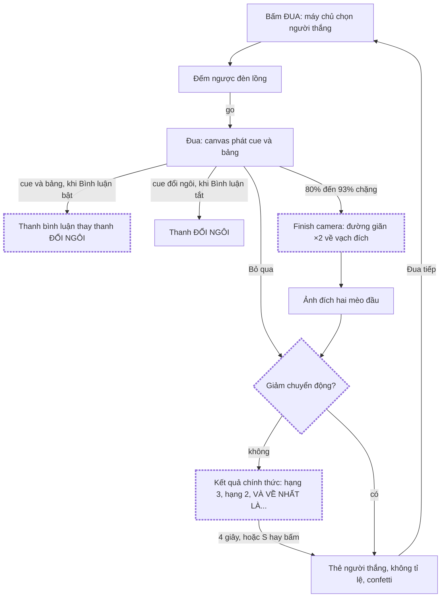
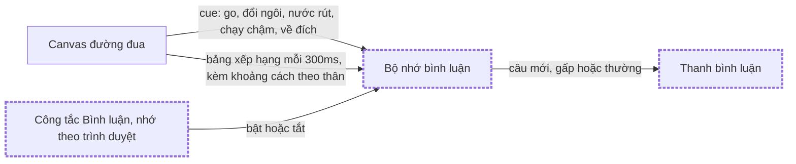

# Đua mèo: bình luận, finish camera và màn công bố

Status: approved

## Problem Statement

Admin tạo vòng đua rồi chia sẻ màn hình lên Discord live cho cả bang xem. Màn đua hiện tại đã đủ
đẹp, nhưng người xem chỉ ngồi nhìn: không ai kể diễn biến, đoạn nước rút trông giống hệt giữa chặng,
và thẻ người thắng bật ra ngay sau ảnh đích. Thẻ kết quả còn in tỉ lệ thắng ("Thắng với 2/5 vé · tỉ
lệ 40%") và dấu "KÈO DƯỚI". Admin không muốn bất kỳ con số tỉ lệ nào xuất hiện trên màn đua, vì nó
khiến cuộc đua trông như đã biết trước kết quả.

## Solution

Giữ nguyên thiết kế màn đua hiện tại và chỉ thêm ba thứ, cộng với việc bỏ tỉ lệ:

- **Commentary** ("Bình luận"): một dòng chữ ở góc dưới trái đường đua, cùng kiểu với thanh "ĐỔI
  NGÔI", kể diễn biến lúc đua: xuất phát, đổi ngôi, mèo bứt từ cuối đoàn lên, nửa chặng, ba mèo dính
  chùm, nước rút, chạy chậm, về đích. Lời bình không bao giờ nêu tên người thắng trước vạch đích.
  Admin bật/tắt bằng công tắc "Bình luận" cạnh ô thời lượng; trình duyệt nhớ lựa chọn. Khi bật,
  thanh "ĐỔI NGÔI" ẩn đi vì bình luận đã nói việc đó.
- **Finish camera**: từ 80% đến 93% chặng, đoạn đường còn lại giãn dần ra gấp đôi về phía vạch đích.
  Mèo giữ nguyên cỡ, cột tên không đổi, cả đoàn vẫn trong khung; chỉ khoảng cách ở nhóm đầu rộng ra.
  Không có công tắc. Tắt khi người xem yêu cầu giảm chuyển động.
- **Reveal** ("Kết quả chính thức"): sau ảnh đích, màn tối lại, hiện "KẾT QUẢ CHÍNH THỨC", gọi hạng
  3, rồi hạng 2, rồi "VÀ VỀ NHẤT LÀ...", chớp sáng, rồi mới mở thẻ người thắng (khoảng 4 giây). Nhấn
  `S` hoặc bấm vào màn để nhảy thẳng tới thẻ. Giảm chuyển động thì mở thẻ ngay.
- **Bỏ tỉ lệ**: thẻ người thắng không còn dòng tỉ lệ và dấu "KÈO DƯỚI". Phần code tính tỉ lệ bị xoá.

Ảnh đích giữ nguyên, vẫn hiện tên hai mèo đầu: đường đua đã cho thấy ai về nhất, màn công bố là
nghi lễ chứ không phải để giữ bí mật.

## Flows

### Một vòng đua đi qua những nhịp nào?



### Lời bình lấy dữ liệu từ đâu?



## User Stories

1. Là người xem stream, tôi muốn có lời bình kể ai đang dẫn, để theo kịp cuộc đua dù chỉ liếc qua.
2. Là người xem stream, tôi muốn nghe gọi tên khi một mèo vượt lên dẫn đầu, để biết lúc nào nên hò
   reo trong chat.
3. Là người xem stream, tôi muốn biết khi một mèo từ cuối đoàn bứt lên, để có lý do hy vọng cho mèo
   của mình đến phút cuối.
4. Là người xem stream, tôi muốn có lời nhắc nửa chặng với hai mèo đầu, để nắm thế trận giữa cuộc
   đua.
5. Là người xem stream, tôi muốn nghe khi ba mèo đầu dính chùm, để biết cuộc đua còn mở.
6. Là người xem stream, tôi muốn lời bình hô "nước rút" và báo chạy chậm, để biết đoạn quyết định đã
   tới.
7. Là người xem stream, tôi muốn lời bình lúc về đích chỉ nói "sát nút" hay "chờ xác nhận" mà không
   nêu tên, để giữ hồi hộp tới màn công bố.
8. Là người xem stream, tôi muốn lời bình không đổi quá dày, để kịp đọc từng câu.
9. Là admin, tôi muốn tắt bình luận bằng một công tắc cạnh ô thời lượng, để chọn màn đua yên tĩnh khi
   cần.
10. Là admin, tôi muốn trình duyệt nhớ công tắc bình luận, để không phải bật lại mỗi lần mở trang.
11. Là admin, tôi muốn công tắc bị khoá khi đang đua, để lời bình không bật tắt giữa chừng.
12. Là admin, tôi muốn thanh "ĐỔI NGÔI" chỉ hiện khi bình luận tắt, để góc đường đua không có hai
    dòng nói cùng một chuyện.
13. Là người xem stream, tôi muốn lời bình nằm đúng chỗ thanh "ĐỔI NGÔI", để màn đua vẫn quen mắt.
14. Là người xem stream, tôi muốn ở đoạn cuối nhóm đầu giãn ra, để nhìn rõ ai hơn ai bao nhiêu.
15. Là người xem stream, tôi muốn mèo không bị phóng to ở đoạn cuối, để cuộc đua không trông như đã
    biết ai về nhất.
16. Là người xem stream, tôi muốn tên mèo ở cột tên luôn đọc được khi camera chạy, để biết mèo nào là
    của ai.
17. Là người xem stream, tôi muốn mọi mèo vẫn trong khung khi camera chạy, để không mèo nào biến mất.
18. Là người xem cần giảm chuyển động, tôi muốn đường đua không giãn ra, để màn hình đứng yên hơn.
19. Là người xem stream, tôi muốn sau ảnh đích có màn "KẾT QUẢ CHÍNH THỨC", để khoảnh khắc trao giải
    có nhịp.
20. Là người xem stream, tôi muốn nghe gọi hạng 3 rồi hạng 2 trước, để hồi hộp chờ người về nhất.
21. Là người xem stream, tôi muốn một chớp sáng khi thẻ người thắng mở, để khoảnh khắc đó nổi bật.
22. Là admin, tôi muốn nhấn `S` hoặc bấm vào màn công bố để mở thẻ ngay, để không phải chờ khi đua
    nhiều vòng liên tiếp.
23. Là admin, tôi muốn màn công bố vẫn chạy sau khi tôi bấm "Bỏ qua" trong lúc đua, để người xem
    vẫn có khoảnh khắc trao giải.
24. Là admin, khi chỉ có một hoặc hai mèo, tôi muốn màn công bố bỏ qua hạng không có, để không hiện
    hạng trống.
25. Là người xem cần giảm chuyển động, tôi muốn thẻ người thắng mở ngay, không có màn công bố.
26. Là admin, tôi muốn thẻ người thắng không còn tỉ lệ và dấu "KÈO DƯỚI", để không ai thấy cuộc đua
    như đã định sẵn.
27. Là admin, tôi muốn thẻ người thắng giữ nguyên phần còn lại (hạng giải, ảnh, tên, class, mèo số
    mấy, hạng 2-3, nút "Đua tiếp", confetti), để màn quen thuộc không đổi.
28. Là admin, tôi muốn confetti chỉ bắn khi thẻ mở, để nó trùng khoảnh khắc người thắng hiện ra.
29. Là admin ở chế độ toàn màn hình, tôi muốn bình luận, camera và màn công bố chạy giống hệt màn
    thường, để stream trông như lúc thử.
30. Là admin, tôi muốn trình đọc màn hình đọc được lời bình, để màn đua vẫn tiếp cận được.

## Implementation Decisions

- **Không đổi API, schema hay `packages/shared`.** Toàn bộ là web, trong feature `cat-race`.
- **Finish camera trong canvas gốc.** Canvas tính một layout "camera" từ layout thật và thời điểm
  đua, rồi dùng nó để vẽ đường đua và đặt mèo. Cột tên, dải trời và đám đông vẫn dùng layout thật,
  nên tên luôn thẳng hàng với làn. Camera giữ cố định điểm đích (mũi mèo ở tiến độ 1) và kéo dài
  quãng đường phía sau, nên mèo không đổi cỡ. Ở chế độ `finish` (đường đua đứng yên sau thẻ), camera
  ở mức giãn tối đa, khớp với khung cuối của cuộc đua. Giảm chuyển động: layout thật. Thuật toán từ
  prototype:

  ```ts
  // from the prototype
  const CAMERA_FROM_U = 0.8, CAMERA_FULL_U = 0.93, CAMERA_STRETCH = 2;
  stretch = 1 + (CAMERA_STRETCH - 1) * smoothstep((u - CAMERA_FROM_U) / (CAMERA_FULL_U - CAMERA_FROM_U));
  finishPoint = layout.startX + layout.travel;
  camera = { ...layout, startX: finishPoint - layout.travel * stretch, travel: layout.travel * stretch };
  ```

  Đây là một hàm thuần trong `lib`, nhận layout, thời điểm đua và cờ bật, trả về layout.
- **Commentary là một bộ nhớ thuần trong `lib`.** Có hai đầu vào: một cue của canvas (`RaceCue`) và
  một lần cập nhật bảng (`RaceStanding[]`) kèm thời điểm. Hàm trả về bộ nhớ mới và có thể kèm một dòng
  mới. Bộ nhớ giữ lúc xuất phát, lúc nói câu gần nhất, những câu đã nói, lịch sử thứ hạng 3 giây gần
  nhất và người dẫn hiện tại. Nguồn ngẫu nhiên được truyền vào để test cố định được câu chữ. Quy tắc:
  - `go`, `sprint`, `slow-motion` bật, `finish` là câu **gấp**: hiện ngay, không chờ.
  - Câu thường cách câu trước ít nhất 2,2 giây, không thì bị bỏ.
  - `lead-change`: nếu 3 giây trước mèo đó đứng hạng 5 trở xuống thì nói "từ hạng X vọt lên dẫn đầu"
    (gấp); không thì một câu đổi ngôi thường.
  - Bảng: sau 25% chặng, một mèo lên ít nhất 4 hạng trong 3 giây và vào top 3 thì gọi "bứt lên" (mỗi
    mèo một lần). Sau 45% chặng thì nói "nửa chặng" một lần, kèm hai mèo đầu. Từ 55% đến 80% chặng,
    nếu mèo thứ ba kém đầu dưới 1 thân thì nói "dính nhau như sam" một lần.
  - `finish`: kém dưới 0,5 thân thì nói "Sát nút! Phải soi ảnh đích!", còn lại nói "Về đích! Chờ
    trọng tài xác nhận...". Không nêu tên.
  - `countdown` không có lời bình, vì đèn lồng đã nói.
  Một hook mỏng giữ bộ nhớ đó cho mỗi vòng, reset khi vòng mới bắt đầu.
- **Thanh bình luận** là một overlay mới của sân khấu, cùng chỗ và cùng kiểu với thanh "ĐỔI NGÔI",
  nhưng đứng yên tới khi có câu mới; mỗi câu mới hiện lên bằng hiệu ứng `race-rise`. Câu "gấp" là
  chữ vàng, câu thường là chữ giấy. Thanh có `aria-live="polite"`. Keyframes và thời lượng nằm trong
  khối `--stage-*` ở `globals.css`, đúng quy ước overlay sân khấu.
- **`RaceStage` nối mọi thứ**: chuyển cue và bảng cho bình luận khi công tắc bật, xoá `leadToast`
  khỏi state overlay trước khi đưa cho `RaceOverlays` khi bình luận bật, và hiện thanh bình luận khi
  đang đua. Live region của `RaceOverlays` vẫn đọc như cũ.
- **Công tắc "Bình luận"** nằm trong `RaceControls` cạnh ô thời lượng và bị khoá khi đang đua. Giá
  trị nằm trong `race-store`, mặc định bật, lưu `localStorage` giống thời lượng: đọc lỗi thì về mặc
  định, ghi lỗi thì vẫn đổi trong phiên.
- **Reveal trong `RaceResultOverlay`.** Overlay có các nhịp: tiêu đề (0 ms), hạng 3 (1100 ms), hạng 2
  (2000 ms), "VÀ VỀ NHẤT LÀ..." (2900 ms), rồi thẻ cùng chớp sáng (4000 ms). Hạng nào không có thì bỏ.
  Bấm vào màn hoặc nhấn `S` (cùng các guard với phím `S` của "Bỏ qua") thì nhảy tới thẻ. Giảm chuyển
  động thì mở thẻ ngay. Confetti chỉ bắn khi thẻ mở. Thẻ giữ nguyên markup và CSS hiện có, chỉ bớt dòng
  tỉ lệ và dấu.
- **Xoá tỉ lệ**: xoá `race-odds` cùng test của nó, CSS `.race-odds`, `.race-stamp` và keyframes
  `race-stamp`.
- **Dọn prototype**: xoá thư mục prototype, route `/dua-meo/prototype` và file HTML thử nghiệm.

## Testing Decisions

- Test hành vi nhìn thấy được, không test chi tiết cài đặt: chữ trên màn, cái gì hiện hay ẩn, giá trị
  layout trả ra.
- **Seam 1 - `RaceStage`** (`race-stage.test.tsx`, canvas đã mock và có thể bắn `onCue` và
  `onStandings`): bình luận bật thì thanh bình luận hiện câu theo cue và thanh "ĐỔI NGÔI" không hiện;
  bình luận tắt thì ngược lại.
- **Seam 2 - `RaceResultOverlay`** (`winners-and-result.test.tsx`, fake timers như các test confetti):
  thứ tự các nhịp; bỏ hạng không có; bấm hoặc `S` mở thẻ ngay; giảm chuyển động mở thẻ ngay; confetti
  chỉ bắn khi thẻ mở; thẻ không còn chữ "tỉ lệ" hay "KÈO DƯỚI". Thay test tỉ lệ và test dấu cũ bằng
  test mới.
- **Seam 3 - lib thuần**: bộ nhớ bình luận (nguồn ngẫu nhiên có seed như `seeded-random.ts`; mỗi quy
  tắc ở trên một test, có test "không nêu tên lúc về đích") và layout camera (trước 80% thì như
  layout thật; tới 93% thì giãn gấp đôi; điểm đích không đổi; tắt thì như layout thật). Prior art:
  `race-cue.test.ts`, `race-layout.test.ts`, `race-chatter.test.ts`.
- `race-store.test.ts` và `race-controls.test.tsx`: công tắc lưu và đọc lại giá trị, mặc định bật, bị
  khoá khi đang đua.
- Canvas không có test pixel. Camera được kiểm qua hàm layout, cộng một lần chạy app bằng mắt.

## Out of Scope

- Âm thanh (trống dồn, chiêng, tiếng đám đông).
- Giấu tên trong ảnh đích.
- Công tắc cho finish camera hay màn công bố.
- Lời bình theo dữ liệu ngoài cuộc đua, như lịch sử thắng hay số vé.
- Đổi chuỗi lời bình đám đông (chat bubbles) đang có trên canvas.
- Màn kết quả của đợt đã kết thúc và Bảng vàng, vì hai màn này không hiện tỉ lệ.

## Further Notes

- Prototype dùng chính các component thật cộng dữ liệu giả, và đã được admin chốt. Prototype bị xoá
  trong cùng PR này.
- Thuật ngữ mới (Commentary, Finish camera, Reveal) đã được ghi vào `GLOSSARY.md`.
